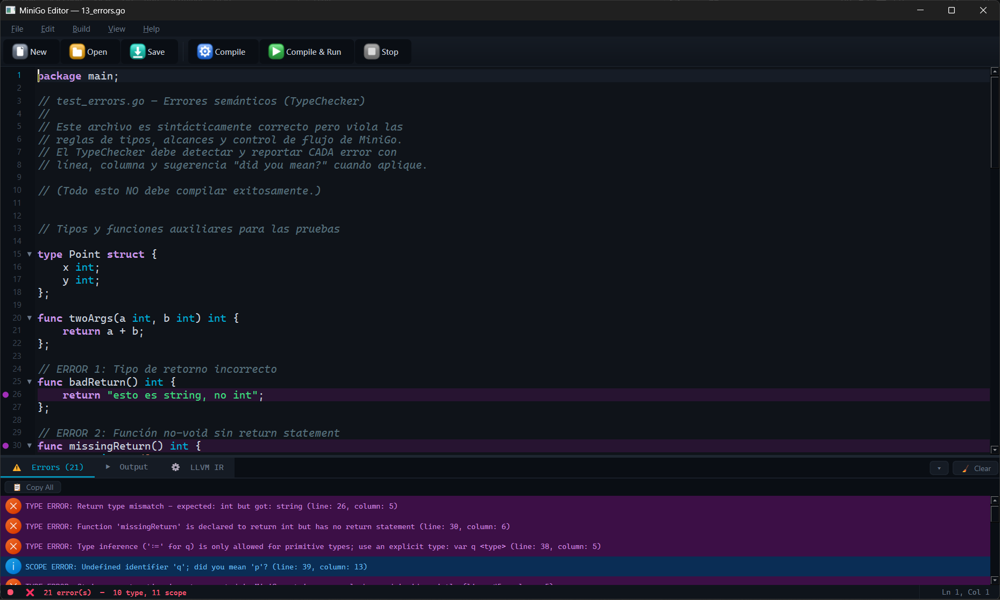
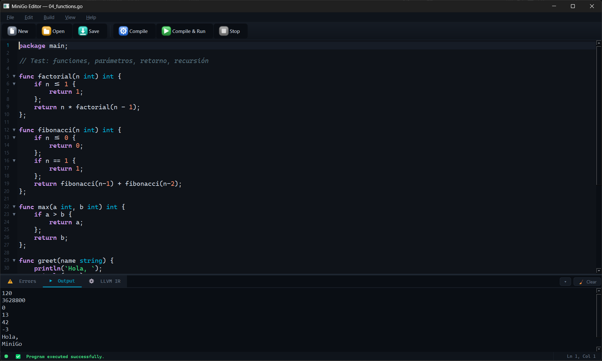
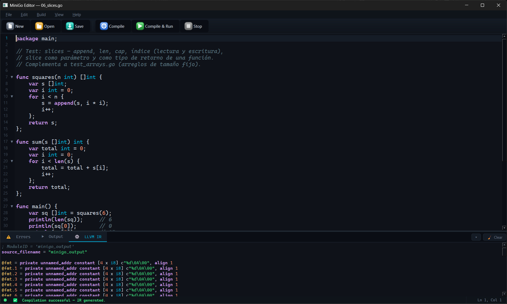
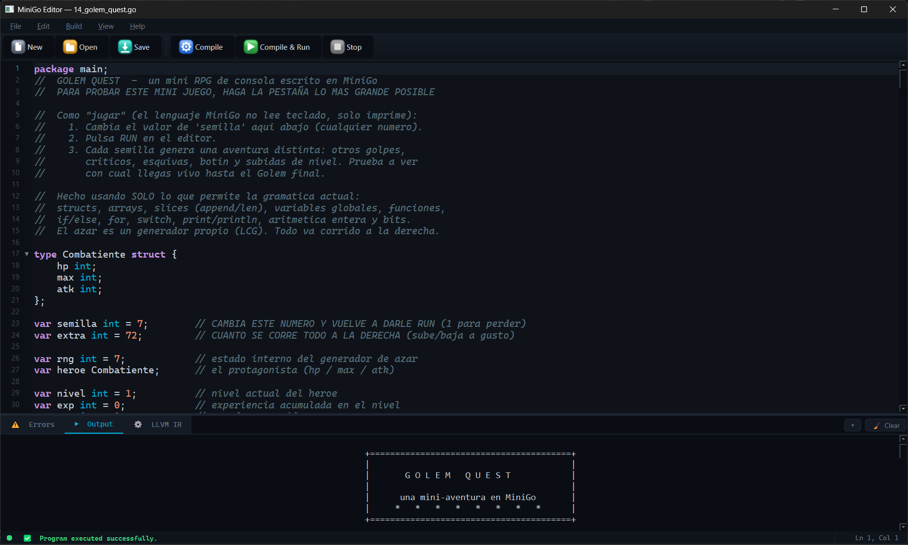
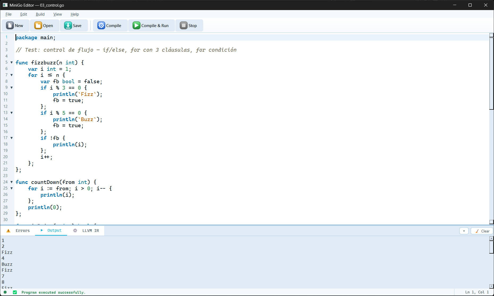
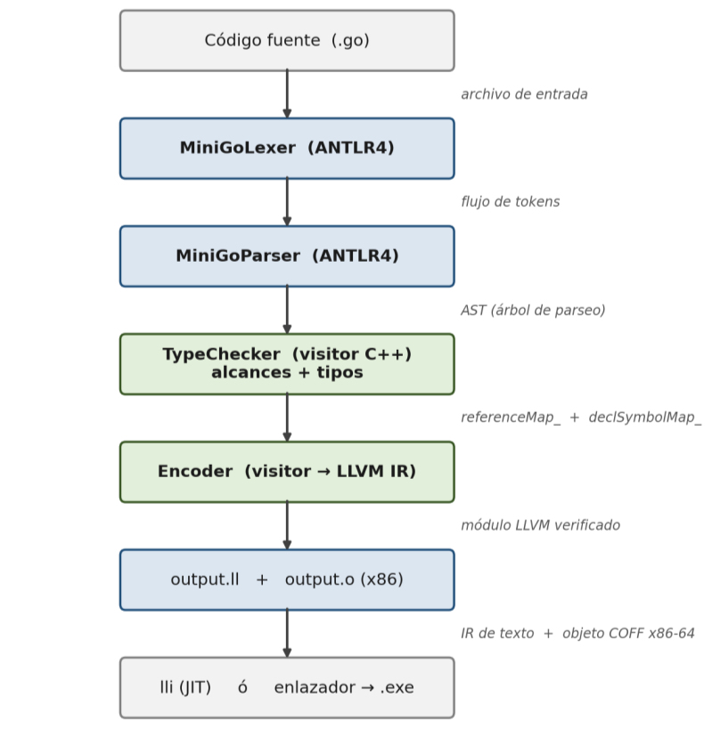
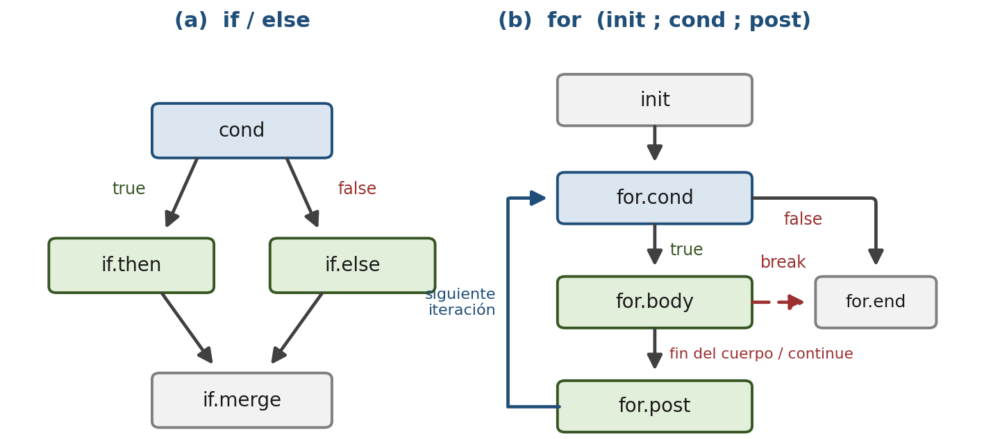
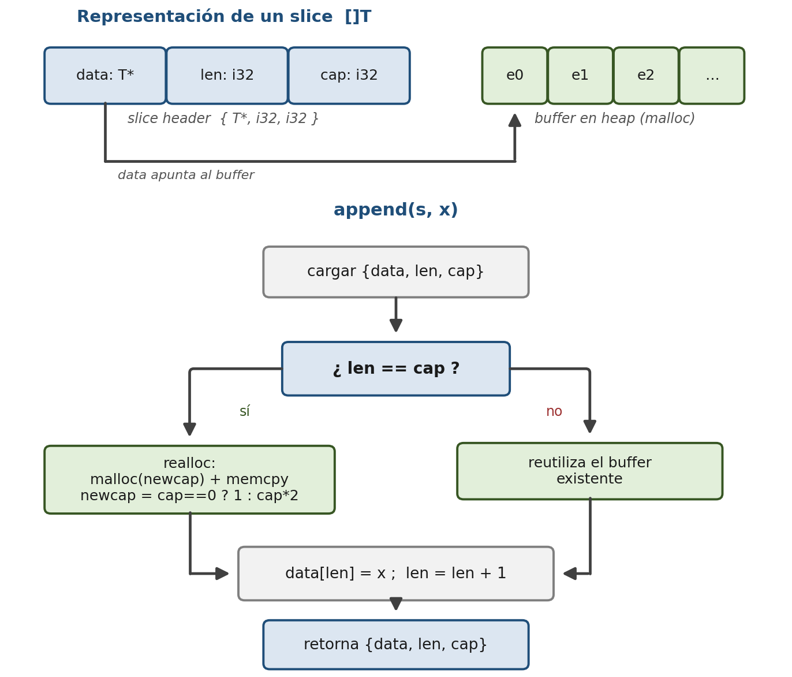

# MiniGo Compiler

Compilador para Mini-GO, un subconjunto del lenguaje Go, desarrollado para el curso
Compiladores e Intérpretes del Instituto Tecnológico de Costa Rica (Sede San Carlos),
I Semestre 2026.

<p align="center"></p>

El compilador realiza análisis léxico, sintáctico, chequeo de tipos y alcances, y
generación de código de máquina real x86-64 usando ANTLR4 y LLVM. Incluye además un
editor gráfico (Qt6) que compila, ejecuta y muestra los errores por línea y columna.

- Frontend: ANTLR4 (scanner + parser)
- Semántica: TypeChecker (tabla de símbolos, alcances, tipos), patrón Visitor
- Backend: Encoder, LLVM IR, objeto x86-64 (`output.o`)
- GUI: Editor Qt6 con resaltado de sintaxis, autocompletado, temas y ejecución

Repositorio: https://github.com/lenokeckler/MINI-GO-LENO

## Capturas

<table>
  <tr>
    <td width="50%" valign="top"><br><sub><b>Compilar y ejecutar.</b> Funciones con recursión (factorial, Fibonacci) compiladas a LLVM y ejecutadas desde el editor.</sub></td>
    <td width="50%" valign="top"><br><sub><b>LLVM IR.</b> Al compilar, el editor muestra el código intermedio que generó el Encoder para slices y <code>append</code>.</sub></td>
  </tr>
  <tr>
    <td valign="top"><br><sub><b>Golem Quest.</b> Un mini RPG de consola escrito solo con lo que permite la gramática: structs, slices, funciones, <code>switch</code> y un generador de azar propio.</sub></td>
    <td valign="top"><br><sub><b>Temas.</b> El editor trae cuatro temas (Clásico, Oscuro, Claro y Go); aquí FizzBuzz con el tema Go.</sub></td>
  </tr>
</table>

La captura de arriba es <code>tests/13_errors.go</code>: 21 errores semánticos (10 de tipos y 11 de
alcance), cada uno con línea, columna y sugerencias del tipo "did you mean?".

## Arquitectura

<p align="center"></p>

<table>
  <tr>
    <td width="50%" valign="top"><br><sub><b>Control de flujo.</b> Bloques básicos que genera el Encoder para <code>if</code>/<code>else</code> y <code>for</code>, con <code>break</code> y <code>continue</code>.</sub></td>
    <td width="50%" valign="top"><br><sub><b>Slices.</b> Cabecera <code>{data, len, cap}</code> con buffer en el heap y crecimiento al doble en <code>append</code>.</sub></td>
  </tr>
</table>

## Tabla de contenidos

- [Capturas](#capturas)
- [Arquitectura](#arquitectura)
- [Instalación automática (Windows)](#instalación-automática-windows)
- [Instalación manual](#instalación-manual)
- [Compilación](#compilación)
- [Uso](#uso)
- [Estructura del proyecto](#estructura-del-proyecto)
- [Archivos de prueba](#archivos-de-prueba)
- [Autor](#autor)

## Instalación automática (Windows)

La forma más fácil: doble clic en `setup_windows.bat`. Instala todo lo necesario (MSYS2,
compilador, CMake, ANTLR4, LLVM, Qt6, Java), compila el proyecto y abre el editor
automáticamente.

Requiere internet. La primera vez descarga el toolchain (1-2 GB) y puede tardar 10-30
minutos; luego ya no descarga nada. Si Windows muestra un aviso (SmartScreen), seleccione
"Más información" y luego "Ejecutar de todas formas".

Para reabrir el editor después: doble clic en `run_editor.bat`.

## Instalación manual

Clonar el repositorio desde GitHub:

```bash
git clone https://github.com/lenokeckler/MINI-GO-LENO.git
cd MINI-GO-LENO
```

El proyecto está pensado para Windows con MSYS2 (entorno UCRT64).

1. Instalar [MSYS2](https://www.msys2.org/).
2. Abrir la terminal "MSYS2 UCRT64" e instalar las dependencias:

```bash
pacman -S --needed \
  mingw-w64-ucrt-x86_64-gcc \
  mingw-w64-ucrt-x86_64-cmake \
  mingw-w64-ucrt-x86_64-ninja \
  mingw-w64-ucrt-x86_64-antlr4-runtime \
  mingw-w64-ucrt-x86_64-llvm \
  mingw-w64-ucrt-x86_64-qt6-base \
  mingw-w64-ucrt-x86_64-jdk-openjdk
```

- LLVM incluye `lli.exe`, necesario para ejecutar los programas desde el editor.
- Java (JDK/JRE 11+) es necesario para ejecutar el JAR de ANTLR4 que genera el parser.
  El JAR (`antlr-4.13.2-complete.jar`) ya viene incluido en el repositorio.

Las rutas por defecto asumen `C:\msys64\ucrt64`. Si instaló MSYS2 en otra ruta, ajuste
`CMAKE_PREFIX_PATH` en `CMakeLists.txt`.

## Compilación

Desde la terminal MSYS2 UCRT64, en la carpeta del proyecto:

```bash
# Con presets (recomendado)
cmake --preset ucrt64-release
cmake --build --preset release

# ...o manual
cmake -S . -B build -G Ninja -DCMAKE_BUILD_TYPE=Release
cmake --build build
```

Esto genera dos ejecutables dentro de `build/`:

| Ejecutable | Descripción |
|---|---|
| `build/minigoc.exe` | Compilador por línea de comandos (CLI) |
| `build/minigo_editor.exe` | Editor gráfico (GUI) |

El parser de ANTLR4 se genera automáticamente desde `grammar/MiniGo.g4` durante la
compilación (requiere Java).

## Uso

### Editor gráfico (GUI)

Una vez compilado, doble clic en `run_editor.bat` (agrega `C:\msys64\ucrt64\bin` al `PATH`
y abre `build\minigo_editor.exe`).

Importante: `run_editor.bat` solo lanza el editor, no compila. Hay que compilar primero;
después el `.bat` funciona siempre.

### Compilador por línea de comandos (CLI)

Desde la terminal MSYS2 UCRT64 (para que encuentre las DLLs de ANTLR y LLVM):

```bash
./build/minigoc.exe tests/01_vars.go
```

La salida esperada al final es `Compilation successful!`. El compilador genera `output.ll`
(LLVM IR) y `output.o` (objeto x86-64). Para ejecutar el programa:

```bash
lli output.ll
```

## Estructura del proyecto

```
MINI-GO-LENO/
├── grammar/
│   └── MiniGo.g4                 # Gramática ANTLR4 del lenguaje
├── src/
│   ├── main.cpp                  # Punto de entrada del CLI (pipeline completo)
│   ├── typechecker/              # Tabla de símbolos + chequeo de tipos/alcances
│   ├── encoder/                  # Generación de LLVM IR + objeto x86
│   ├── errors/                   # Listener de errores léxicos/sintácticos
│   └── editor/                   # Editor gráfico Qt6 (CodeEditor, temas, highlight)
├── tests/                        # Archivos de prueba .go (ver abajo)
├── documentation/                # Documentación del proyecto
│   └── img/                      # Capturas del editor y diagramas
├── antlr-4.13.2-complete.jar     # Generador del parser
├── CMakeLists.txt
└── run_editor.bat
```

## Archivos de prueba

Los tests están numerados, de lo más simple a lo más complejo:

| #  | Archivo | Demuestra |
|----|---------|-----------|
| 01 | `01_vars.go` | Variables globales/locales, tipos básicos, asignaciones |
| 02 | `02_operators.go` | Operadores aritméticos, compuestos, bitwise, lógicos |
| 03 | `03_control.go` | `if`/`else`, `for` (todas las variantes) |
| 04 | `04_functions.go` | Funciones, parámetros, retorno, recursión |
| 05 | `05_arrays.go` | Arreglos de enteros, índice, `len` |
| 06 | `06_slices.go` | Slices, `append`/`len`/`cap`, paso por parámetro/retorno |
| 07 | `07_strings.go` | Raw strings e interpreted strings con escapes |
| 08 | `08_structs.go` | Structs, campos, slices |
| 09 | `09_types.go` | Impresión de todos los tipos simples + `switch` |
| 10 | `10_new_features.go` | `break`, `continue`, `switch`, struct GEP, cortocircuito |
| 11 | `11_errors_lexer.go` | Errores léxicos (caracteres inválidos) |
| 12 | `12_errors_parser.go` | Errores sintácticos |
| 13 | `13_errors.go` | Errores semánticos (tipos y alcances) |
| 14 | `14_golem_quest.go` | Programa de ejemplo más extenso |
| 15 | `15_errors_strings.go` | Errores en literales de string |

Los archivos `11`, `12`, `13` y `15` están diseñados para fallar y demostrar el reporte de
errores con línea, columna y sugerencias del tipo "did you mean?".

## Autor

Magdaleno Gómez Díaz, 2023395761

Compiladores e Intérpretes, ITCR Sede San Carlos, I Semestre 2026

Profesor: Óscar Vásquez Acuña
